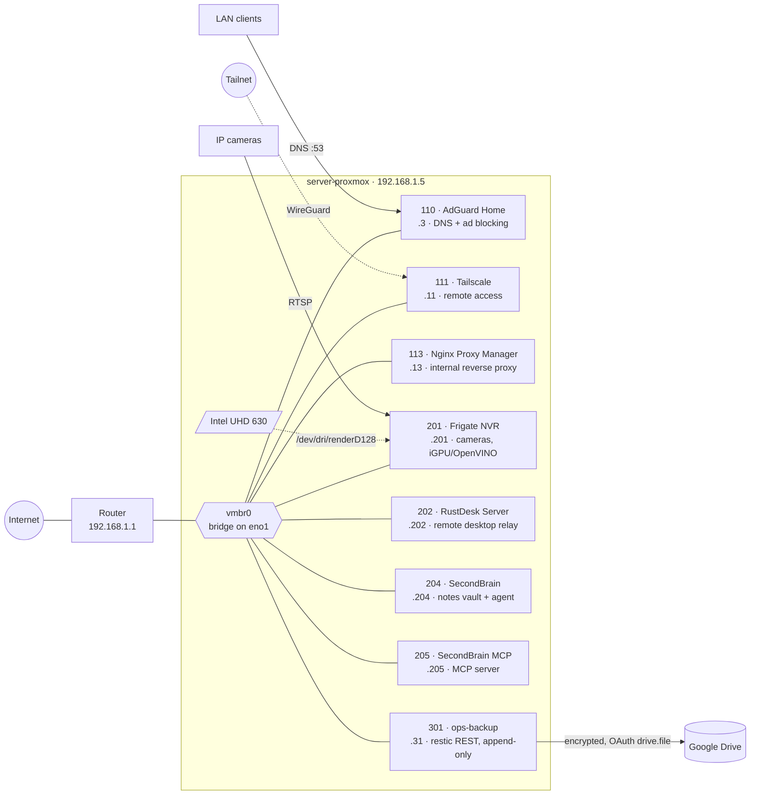

<p align="center">
  <picture>
    <source media="(prefers-color-scheme: dark)" srcset="docs/img/proxmox-logo-dark.png">
    
  </picture>
</p>

# Proxmox Homelab

Configuration for a single-node Proxmox VE host that runs the real
infrastructure of my home: ad-blocking DNS, security cameras, a reverse proxy,
remote access, a personal knowledge base, and encrypted offsite backups.

This repo tracks the state of the host and every guest so that changes are
reviewable, reversible and documented.

## Hardware

| | |
|---|---|
| CPU | Intel Core i5-9500 (6C/6T, VT-x, VT-d) |
| RAM | 16 GB DDR4 |
| Storage | 256 GB NVMe (WD SN530) — LVM + ext4, single disk |
| Network | 1× 1 GbE onboard |
| Hypervisor | Proxmox VE 9.2 on Debian 13 (trixie) |

## Architecture



## Services

| ID | Name | Role | Resources |
|---|---|---|---|
| 110 | `net-adguard` | DNS for the whole LAN with ad/tracker blocking | 1 vCPU · 2 GB · 6 GB |
| 111 | `net-tailscale` | VPN node for remote access to the LAN | 1 vCPU · 512 MB · 4 GB |
| 113 | `net-nginx-proxy-manager` | Reverse proxy for internal services | 2 vCPU · 2 GB · 8 GB |
| 201 | `app-frigate` | NVR with object detection on the iGPU (OpenVINO) | 2 vCPU · 3 GB · 32 + 64 GB media |
| 202 | `app-rustdeskserver` | Self-hosted RustDesk ID/relay server | 1 vCPU · 512 MB · 4 GB |
| 204 | `app-secondbrain` | Personal knowledge vault and its agent | 2 vCPU · 6 GB · 24 GB |
| 205 | `app-secondbrain-mcp` | MCP server exposing the vault to AI clients | 2 vCPU · 3 GB · 16 GB |
| 301 | `ops-backup` | Offsite backup gateway: restic REST server on Google Drive | 1 vCPU · 512 MB · 4 GB |

Naming and ID ranges: `net-*` (1xx) network plumbing, `app-*` (2xx)
user-facing services, `ops-*` (3xx) operations such as backup and monitoring.
Every guest uses AdGuard (`.3`) as its resolver and sits on the single
bridge `vmbr0`.

## Repository layout

```
proxmox/
├── lxc/        # /etc/pve/lxc/<id>.conf — one file per container
└── host/       # interfaces, storage.cfg, fstab, firewall/, sshd_config.d/, fail2ban/, cron.d/
services/       # config of what runs inside the containers, secrets redacted
├── adguard/
├── frigate/
├── nginx-proxy-manager/
└── backup/                  # CT 301: rclone-restic.service, restic-maint
scripts/
├── lib/common.sh            # logging, job lock, mail on failure
├── backup-offsite.sh        # daily: every guest + host config → restic → Drive
├── backup-maintenance.sh    # weekly: retention, integrity, freshness, report
├── restore-drill.sh         # monthly: restore a guest from Drive and boot it
├── update-lxcs.sh           # weekly guest updates + OS release audit
├── update-host.sh           # weekly host upgrade + config drift check
└── export-config.sh         # copy live config into the repo
docs/
├── backup.md                # backup design, threat model, restore runbooks
└── update-policy.md         # update rules and how each is enforced
```

`proxmox/` files are exact copies of the host's configuration. `services/`
files are copied out of the containers with passwords, stream credentials and
private keys replaced by `<redacted>`. The repo documents the host and does
not deploy it: `scripts/export-config.sh` copies the live configuration in,
and the weekly `update-host.sh` mails a warning when the two differ.

## Decisions

- **LXC over VMs.** Every service is a Linux daemon that does not need its own
  kernel. Containers boot in seconds, share the host's memory efficiently and
  make the iGPU passthrough to Frigate a one-line `dev0:` entry instead of
  PCIe passthrough.
- **Unprivileged everywhere.** Root inside a container maps to an unprivileged
  UID on the host. The only exception is Tailscale, which needs `/dev/net/tun`
  bind-mounted — still unprivileged.
- **Static IPs in the guest config**, not DHCP reservations. The router is
  not something I control from a repo yet; `pct config` is.
- **Host firewall is default-deny.** Only SSH, the web UI, SPICE and ICMP are
  accepted, and only from the `management` IPSet (home LAN and tailnet).
  Root SSH is key-only; fail2ban watches both sshd and the Proxmox login.
- **Updates take a backup first.** `scripts/update-lxcs.sh` runs `vzdump` on
  each container before `apt dist-upgrade`, so a bad update is a `pct restore`
  away. It replaced a `curl | bash` cron that ran unreviewed code as root.
- **Encrypted, verified offsite backups.** Every guest is streamed from
  `vzdump` into restic (deduplicated, compressed, encrypted) and stored on
  Google Drive through a dedicated container. The host cannot delete
  backups, only add them. Integrity is checked weekly and a real restore is
  rehearsed monthly. Details in [docs/backup.md](docs/backup.md).
- **Failures are mailed, not just logged.** Every job reports through the
  Proxmox notification system to Gmail, and a weekly backup report arrives
  even when everything is fine, so its absence is itself an alert.
- **Patched on a schedule.** Host security fixes daily, everything else
  weekly, guests weekly with a release audit. See
  [docs/update-policy.md](docs/update-policy.md).
