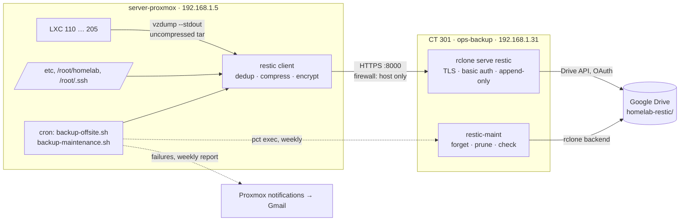

# Backup and recovery

How every container and the host configuration are backed up offsite, how
the backups are verified, and how to restore them.

## Objectives

| | Target | How it is met |
|---|---|---|
| **RPO** (max data loss) | 24 h | Daily snapshot of every guest at 02:30 |
| **RTO** (time to restore one guest) | < 1 h | Measured monthly by the restore drill (`restore-drill.sh`) |
| **Retention** | 7 daily · 4 weekly · 12 monthly | `restic forget` every Sunday |
| **Confidentiality** | Encrypted before leaving the host | restic: AES-256-CTR + Poly1305, key derived with scrypt |
| **Integrity** | Detect silent corruption | `restic check --read-data-subset=5%` weekly; content-addressed storage |
| **Alerting** | Any failure reaches a human | Mail to Gmail through the Proxmox notification system; weekly report as proof of life |

## Architecture



### Data flow

1. `backup-offsite.sh` runs `vzdump <id> --stdout --compress 0 --mode suspend`
   for each guest and pipes the tar straight into
   `restic backup --stdin-from-command`. Nothing is written to local disk
   except vzdump's suspend-mode staging copy, deleted after each guest.
2. Because the tar is uncompressed, restic's content-defined chunking finds
   the unchanged blocks from previous days. Only new chunks are compressed
   (zstd), encrypted and uploaded.
3. `--stdin-from-command` means a failed `vzdump` produces **no** snapshot
   instead of a truncated one.
4. The host configuration (`/etc` including `/etc/pve`, the repo, SSH keys,
   crontabs) is a second, file-level snapshot tagged `host-config`.

### Why this design

| Decision | Alternative considered | Reason |
|---|---|---|
| restic with vzdump piped in | Upload `vzdump .tar.zst` files with rclone | Compressed archives do not deduplicate: every night would be a full upload. Piping the raw tar into restic makes nights incremental and adds encryption and integrity checks. |
| Dedicated container for the Drive connection | rclone on the host | The hypervisor never holds cloud credentials. The OAuth token lives only in CT 301. |
| Append-only REST server for the host | Host talks to Drive directly | The daily job can add snapshots but cannot delete or rewrite them. A bug or a mistaken command on the host cannot wipe history. |
| Separate restic key for maintenance | One key for everything | The key that may prune exists only in CT 301. The host's key and REST account cannot delete. |
| `drive.file` OAuth scope | Full `drive` scope | rclone can only see the files it created, not the rest of the Drive. |
| Weekly 5 % data check + monthly real restore | Trust that uploads succeeded | Backups that are never restored are hopes, not backups. The drill measures RTO with a real guest. |
| Proxmox Backup Server | — | Best fit for Proxmox, but it needs its own disk or S3 target. Google Drive was the available offsite medium. PBS stays on the roadmap. |

## Schedule

| When | Job | What |
|---|---|---|
| Daily 02:30 | `backup-offsite.sh` | Every guest except 301, plus host config |
| Saturday 10:00 | `update-lxcs.sh` | Local `vzdump` before each guest update (keep 2, quick rollback) |
| Sunday 05:00 | `backup-maintenance.sh` | Retention + prune, integrity check, freshness (< 36 h), weekly report |
| 1st Sunday of the month | `restore-drill.sh 202` | Restore CT 202 from Drive as CT 9202, boot it, destroy it, report the time |

All jobs share a lock (`/run/lock/homelab-jobs.lock`) so vzdump, apt and
restic never overlap.

## 3-2-1 status

| Rule | Status |
|---|---|
| 3 copies | Production + offsite (Drive) + pre-update `vzdump` (only the last 2 per guest, weekly) |
| 2 different media | ⚠️ Partial: the local `vzdump` copies share the NVMe with production |
| 1 offsite | ✅ Google Drive, encrypted |

Closing the gap needs a second local disk (USB or SATA) as a `vzdump` or PBS
target. See the roadmap.

## What is and is not backed up

| Included | Excluded (re-creatable) |
|---|---|
| Root filesystem of every guest | Frigate recordings (`mp0`, `backup=0`): 64 GB of rolling video |
| Host `/etc` (incl. `/etc/pve`), `/root/homelab`, `/root/.ssh`, crontabs | Frigate Docker images (`/var/lib/docker`): `docker compose pull` |
| | APT caches, `/var/tmp` |
| | CT 301 itself: rebuilt from this document |

Exclusions live in `scripts/backup-excludes.conf`.

## Secrets and where they live

| Secret | Location | Escrow |
|---|---|---|
| Repository password (decrypts everything) | Host `/root/.config/restic/repo-password` (0600) | **Password manager, offline copy.** Without it the backups are unreadable. |
| REST account (append-only) | Host `homelab.env`; bcrypt/apr1 hash in CT 301 `/etc/rclone/htpasswd` | Re-creatable |
| Maintenance restic key | CT 301 `/var/lib/rclone/restic-maint.password` | Re-creatable from the repository password |
| Google OAuth token (`drive.file`) | CT 301 `/var/lib/rclone/rclone.conf` | Re-created with `rclone config reconnect` |
| TLS key | CT 301 `/etc/rclone/tls.key`; host pins the cert | Re-creatable |
| Gmail app password | `/etc/pve/priv/notifications.cfg` | Re-created in the Google account |

None of these are in git (`.gitignore` blocks `*password*`, `*.env`, `*.key`).

## Threat model

| Event | Outcome |
|---|---|
| NVMe dies | Reinstall Proxmox, restore host config, rebuild CT 301, restore every guest from Drive |
| Bad update breaks a guest | `pct restore` from the local pre-update `vzdump` (minutes) |
| Accidental `restic forget` or a script bug on the host | Refused: the host's REST access is append-only |
| Prune deletes something by mistake | rclone moves deleted files to the Drive trash, recoverable for 30 days |
| Google account compromised | Attacker gets ciphertext only; the repository password is not in Drive |
| Root on the Proxmox host compromised | Can reach CT 301 with `pct exec` and delete. Mitigated only by Drive trash (30 days). Real immutability needs object lock (see roadmap). |
| Backups silently stop | Freshness check fails after 36 h; the weekly "OK" report stops arriving |

## Runbooks

All commands run on the Proxmox host as root unless stated.

```bash
set -a; source /root/.config/restic/homelab.env; set +a
restic snapshots --compact                     # list everything
restic snapshots --tag ct-201 --latest 3       # one guest
```

### Restore a container in place

```bash
ID=113
SNAP=$(restic snapshots --tag ct-$ID --latest 1 --json | jq -r '.[-1].short_id')
FILE=$(restic snapshots --tag ct-$ID --latest 1 --json | jq -r '.[-1].paths[0]')
pct stop $ID
restic dump "$SNAP" "$FILE" | pct restore $ID - --storage local --force 1
pct start $ID
```

For CT 201 (Frigate) the Docker images are not in the backup. Run
`pct exec 201 -- sh -c 'cd /opt/frigate && docker compose pull && docker compose up -d'`.

### Restore a container next to the original (inspect files)

Use `restore-drill.sh <id>` as a template, or restore to a free VMID and
remove `net0` before starting it so its IP and MAC do not clash.

### Restore single files from the host config

```bash
restic restore latest --tag host-config --target /tmp/restore --include /etc/pve/lxc
```

### Disaster recovery: new disk or new machine

1. Install Proxmox VE 9, same hostname `server-proxmox`, IP `192.168.1.5`.
2. `git clone` this repository to `/root/homelab`.
3. Rebuild CT 301 by following "Rebuild CT 301" below.
4. Copy the repository password from the password manager to
   `/root/.config/restic/repo-password`, recreate `homelab.env`.
5. `restic restore latest --tag host-config --target /` for `/etc/pve` and
   cron, firewall and network files. Review `/etc/network/interfaces` first.
6. Restore each guest with the in-place runbook, DNS (110) first.

### Rebuild CT 301

1. Create the container from `proxmox/lxc/301.conf` and
   `proxmox/host/firewall/301.fw`, then install `rclone restic openssl`.
2. Create user `rclone`, `/var/lib/rclone` (0700) and `/etc/rclone` (TLS cert,
   key, `htpasswd`) as described in the `services/backup/` file headers.
3. `runuser -u rclone -- rclone config --config /var/lib/rclone/rclone.conf`:
   remote `gdrive`, type `drive`, scope `drive.file`, headless authorisation
   with `rclone authorize "drive"` on a machine with a browser.
4. Install `services/backup/rclone-restic.service` and `restic-maint`, then
   `systemctl enable --now rclone-restic`.
5. On the host, add a maintenance key:
   `restic key add --new-password-file <file>`, then copy that file to
   `/var/lib/rclone/restic-maint.password` in CT 301 and delete it from the host.

## Roadmap

- **Second local medium.** USB or SATA disk as a `vzdump` or PBS datastore,
  to complete 3-2-1 and make big restores fast.
- **Immutable offsite copy.** S3 with object lock (Backblaze B2, Wasabi), or a
  PBS 4 S3 datastore, so that even root on the host cannot delete history.
- **Own Google Cloud OAuth client** for rclone, published to production, to
  avoid the shared client's rate limits.
- **External dead-man's switch** (e.g. healthchecks.io) so a host that is
  completely down also raises an alert.
